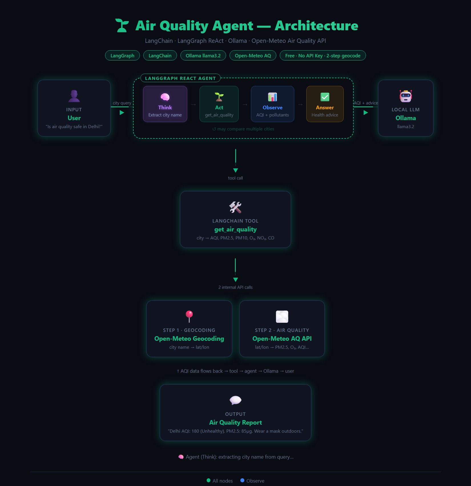

<div align="center">

# 🌿 Air Quality Agent

**Ask about any city. Get live air quality and plain-English health advice.**

An AI agent built with **LangChain + LangGraph + Ollama** that fetches real-time pollution data
and turns raw numbers into clear, caring, actionable advice. It's free, runs locally, and needs no API keys.


</div>

---

## 🎬 Video Walkthrough (3 min)

https://github.com/user-attachments/assets/4163e4cb-4d1c-40b5-a800-55812ce0f6e8

<p align="center"><i>Live demo with real data · architecture deep-dive · code walkthrough · how to run it</i></p>

---

## ✨ What it does

- 💬 **Natural questions**: *"Is the air safe in Delhi today?"*, *"Should I exercise outside in Beijing?"*
- 🌍 **Any city worldwide**, with live data from the free [Open-Meteo](https://open-meteo.com/) Air Quality API
- 📊 **Full pollutant breakdown**: European AQI, PM2.5, PM10, NO₂, Ozone, CO
- 🩺 **Health-first answers**: who is at risk (children, elderly, people with asthma) and what to do
- 🔒 **Local & private**: the LLM runs on your machine through Ollama

## 🚀 Quick start

```bash
pip install -r requirements.txt   # langchain, langchain-ollama, langgraph, requests
ollama pull llama3.2              # free local model (install Ollama from https://ollama.com)
python agent.py                   # type 'quit', 'exit' or 'q' to leave
```

## 🏗️ Architecture & how it works

<p align="center">
  
</p>

> 💡 Open [`architecture.html`](architecture.html) in a browser for the **animated** version of this diagram.

1. **Think**: the model reads the question and extracts the city name.
2. **Act**: it calls the `get_air_quality(city)` tool.
3. **Observe**: the tool geocodes the city, fetches current readings, and maps the AQI to a health label.
4. **Answer**: the model explains the reading in plain language with practical precautions.

## 📈 AQI scale used

| European AQI | Level | Health advice |
|---|---|---|
| 0–20 | 🟢 Good | Excellent. Safe for all outdoor activities. |
| 21–40 | 🟡 Fair | Acceptable. Sensitive groups should monitor. |
| 41–60 | 🟠 Moderate | Unusually sensitive people may notice. |
| 61–80 | 🔴 Poor | Everyone may start to experience health effects. |
| 81–100 | 🟣 Very Poor | Health warnings. Limit prolonged outdoor exertion. |
| > 100 | ⚫ Extremely Poor | Health alert: everyone should avoid outdoor activity. |

## 💬 Example

```text
You: Is the air safe in Delhi today?

[tool] get_air_quality('Delhi')
  Air Quality: Delhi, India
  AQI (European) : 106 — Extremely Poor
  PM2.5 : 68.0 µg/m³    PM10  : 71.7 µg/m³
  NO₂   : 18.3 µg/m³    Ozone : 186.0 µg/m³

Agent: The air in Delhi is extremely poor right now (AQI 106).
  • Avoid outdoor exercise — especially kids, elderly and people with asthma
  • Wear an N95 mask if you must go outside
  • Keep windows closed; run an air purifier if you can
```

<sub>Tool output above is real Open-Meteo data captured on 21 Nov 2026. The agent's wording will vary from run to run.</sub>

## 📁 Project structure

```text
air_quality_agent/
├── agent.py                 # ReAct agent: system prompt, build_agent(), ask(), CLI loop
├── tools.py                 # get_air_quality tool: geocoding + air quality + AQI labels
├── architecture.html        # animated architecture diagram
├── prompt.md                # technical prompts & design decisions
├── prompt_nontechnical.md   # plain-English guide
├── requirements.txt
└── assets/                  # architecture image and demo video
```

## 🧠 Engineering highlights

| | |
|---|---|
| **ReAct tool calling** | The LLM reasons, calls a typed LangChain tool, observes the result, then answers |
| **Local-first AI** | Ollama + llama3.2, so there's no cloud LLM cost and your questions stay on your machine |
| **Separation of concerns** | `tools.py` handles data access; `agent.py` handles reasoning and conversation |
| **Zero-config data** | Two-step Open-Meteo pipeline (geocode → air quality) with no API key needed |
| **Easy to extend** | Add forecasts, pollution alerts, or multi-city comparisons as new tools |

## ⚠️ Limitations

- Not a medical device. Consult a doctor for health decisions.
- Readings are modelled for the city's coordinates; your neighbourhood may differ.
